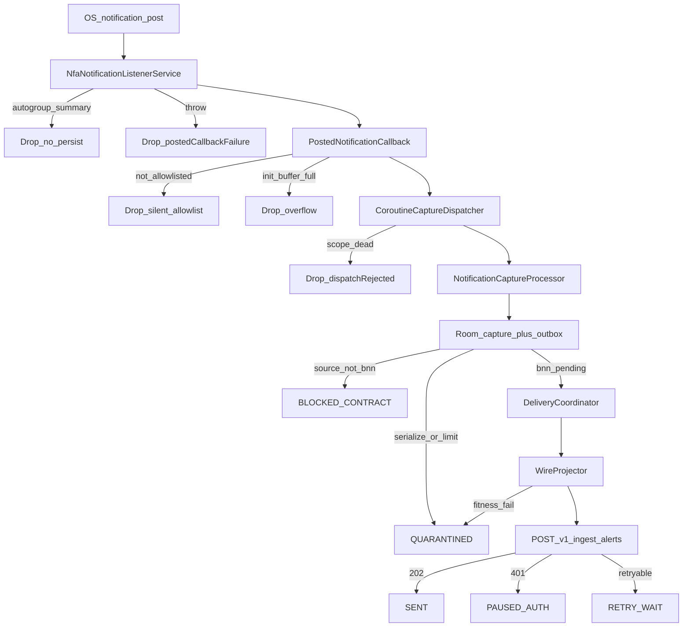

# Capture → delivery audit — 2026-10-02

**Companion:** [2026-10-02-capture-miss-findings.md](2026-10-02-capture-miss-findings.md)  
**Docs pack:** [../reference/capture-reliability/MANIFEST.md](../reference/capture-reliability/MANIFEST.md)  
**Scope:** Code + device evidence audit. **No product code changes in this phase.**

## A. Shared 18/60 miss — ranked tests

See findings doc for full ranking. Summary after FIRST TEST follow-up + Oct 1 timeline:

1. **Selective non-delivery to third-party listeners** — lead.
2. Simultaneous listener outage — weaker; no durable connect telemetry; live captures continue through the window.
3. Async persist crash window — real defect class; not the Oct 1 signature.
4. Type filters — weakened by manifest + dump + operator check.
5. Quiet/cooldown — UX only.
6. Autogroup child loss — disproven when OS delivers children.
7. Live callback generally broken — **disproven** for the 33 active tags (all live-likely lag).

---

## B. Full pipeline and drop points

### Stage table (file:symbol)

| Stage | Symbol |
|---|---|
| Binder entry | `NfaNotificationListenerService.onNotificationPosted` |
| Autogroup skip | `isSystemAutogroupSummary` (`FLAG_GROUP_SUMMARY` + `FLAG_LOCAL_ONLY`) |
| Clone → lightweight | `toLightweight` — **silent fallback** if clone fails |
| Allowlist / init buffer | `PostedNotificationCallback` |
| Async dispatch | `CoroutineCaptureDispatcher.dispatch` → `scope.launch` |
| Envelope + persist | `NotificationCaptureProcessor.process` → Room |
| Catch-up | `reconcileActiveNotifications` → `ActiveNotificationCatchUp` |
| Drain | `DeliveryCoordinator` / WorkManager |
| Wire | `WireProjector` |
| HTTP | `OkHttpIngestClient` |

### Drop / block / quarantine points

| Point | Effect | Recorded today? |
|---|---|---|
| Autogroup summary | Skip | No counter |
| Posted callback throwable | Skip | `postedCallbackFailureCount` (memory) |
| Clone failure | Uses live binder object | **Silent** |
| Not allowlisted | Skip | No counter on live path |
| Init buffer overflow | Skip | `initializationOverflowCount` |
| Dispatch scope inactive | Skip | `dispatchRejectedCount` |
| `activeNotifications` failure | Empty catch-up | **Silent** |
| Non-BNN source | `BLOCKED_CONTRACT` | Outbox state |
| Envelope/serialize failure | `QUARANTINED` | error codes |
| Wire fitness / HTTP 400 | `QUARANTINED` | error codes |
| Auth missing / 401 | `PAUSED_AUTH` | yes |
| Network / 429 / 503 | `RETRY_WAIT` | yes |

### Receiver-side issues (nfa-platform) — read-only

| Issue | Detail |
|---|---|
| `source` allowlist | Live contract is **`bnn` only** (schema-v1). |
| `commit_raw_alert` | Hardcodes `source='bnn'` in DB path — non-bnn body risk of silent remap if gateway is loose. |
| Multi-app delivery | Requires approved amendment (enum expand, CHECK, persist request source, importer policy). **Out of scope for this repo to change.** |
| Limits | 256 KiB body / 128 KiB rawText / 32 KiB metadata — unchanged for multi-source. |

Collector correctly keeps non-BNN as local `BLOCKED_CONTRACT` until that amendment is approved.

---

## C. Crash / disconnect resilience checklist

| # | Requirement | Current status | Evidence |
|---|---|---|---|
| C1 | No loss between callback return and durable persist | **Gap** | `CoroutineCaptureDispatcher` returns after `launch`; Room write is async |
| C2 | Binder copy failure recorded, never silent fallback | **Gap** | `toLightweight` `getOrElse { sbn.notification }` |
| C3 | Ranking-aware posted callback | **Gap** | Only `onNotificationPosted(sbn)` |
| C4 | Catch-up on connect / reconnect / while connected; no duplicate flood | **Partial** | WIP: connect + 60s reconcile + keep-alive; identity `package/key/postTime`; cannot recover dismissed History posts |
| C5 | Restart after reboot / update / crash / disconnect | **Partial** | Boot + package replaced receiver; `requestRebind` on disconnect; FGS specialUse; direct-boot / locked-before-unlock **unproven** |
| C6 | Type-filter narrowing detection + on-screen warning | **Absent** | Manifest declares all types; no runtime check/UI |
| C7 | Miss telemetry durable + exportable per app per hour | **Absent / weak** | In-memory `ListenerStatus`; `diagnostic_events` empty; no live-vs-catch-up field |
| C8 | Android 16 sensitive redaction detection | **Absent** | No explicit redaction reason on capture |
| C9 | No swallowed exceptions on capture path | **Partial** | Outer posted catch counted; clone + shade-empty paths silent; `onPersisted` errors ignored after Room write |

### Live vs catch-up (audit ranking note)

FIRST TEST follow-up: **0/33** active tags look catch-up-only. Therefore the live callback path is **not** ranked as the cause of those Room rows. C1 remains a **forward-looking** defect (can lose posts the OS *did* deliver if the process dies mid-async), distinct from the Oct 1 selective non-delivery lead.

---

## D. Competing apps assessment

| App | Risk |
|---|---|
| MacroDroid | Parallel backup; same 18 miss → not “MacroDroid stole posts from collector.” Keep until soak. |
| OpenClaw / AlertSheets / MobileClaw | Extra NLS clients; can stress system; were toggled 2026-10-02. Prefer disabled on primary phone. |
| Buzzkill | Notification-modifying listener — can cancel/repost; monitor if oracle shows cancel storms. |

---

## E. Planned Phase 5 oracle (not implemented yet)

1. Capture: `adb -s R3GL605J0AH logcat -b events -v time` → gitignored file.
2. Filter enqueue/cancel for selected packages.
3. Export Room identities (package, key/tag, postTime) — no content.
4. Compare script: match oracle ↔ Room; report missing enqueues and cancels without Room row.
5. History remains secondary manual check.

---

## F. WIP keep / change later

**Keep:** shade reconcile, keep-alive, rebind, posted failure counter, binder clone attempt, autogroup summary skip, outbox-first delivery.

**Change only after Phase 3+ approval:** durable journal before binder return; RankingMap; recorded clone failures; durable miss counters + capturePath; type-filter UI; events oracle scripts; grant scripts; multi-source amendment doc (collector stays BLOCKED for non-approved sources).

---

## G. Hard ceilings (non-root)

- No public Notification History API.
- No privileged unredacted sensitive notification access for sideloaded apps.
- Catch-up cannot resurrect dismissed posts.
- Do not claim “never miss” without locked-screen soak + events-oracle parity.
